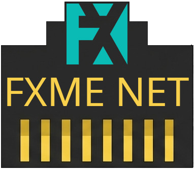
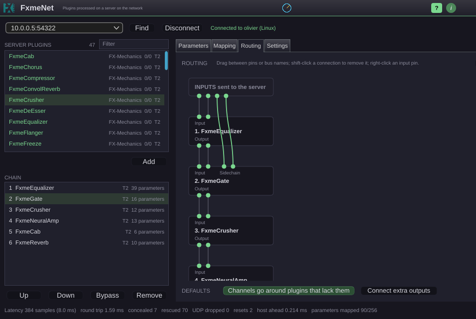

<p align="center">
  
</p>

# FxmeNet

FxmeNet lets your DAW run its effects on another computer. In the DAW you
insert one plugin, **FxmeNet** (VST3, AU on macOS). Behind it, a chain of VST3
effects runs on a **server** (`fxmenet-server`) on the same local network. The
audio goes to the server and comes back; the DAW sees one ordinary plugin and
compensates the latency it reports.

Use it when a session with many heavy plugins exhausts the CPU of the computer
that runs the DAW. In our tests, 24 tracks with 17 plugins each used 75 % of the
client's processor when processed locally, and just a few percent through FxmeNet
(the necessary calculations to send audio back and forth on the network).

Made by [FX-Mechanics](https://fx-mechanics.com).



## What it does

- **Native editors.** If a plugin is installed on the client too, its own editor
  opens locally and stays in step with the server's copy. Plugins made for
  FxmeNet also show their real meters and analysers. Others get a generic panel
  of sliders.
- **Chains and routing.** Each plugin instance in the DAW is one session on the
  server, with its own chain, a routing patchbay and latency compensation.
- **Latency against reliability.** Audio travels in blocks of N samples (32 to
  1024) over UDP, and each reply has D blocks (1 to 8) to come back. A late block
  is concealed with a short fade. The added latency is about N × D samples.
- **Monitoring.** `fxmenet-top` is a terminal program that shows sessions, CPU,
  network and the server log, and manages the server's plugin folders (Linux,
  macOS and Windows).


Please note:

- Even if the addedlatency stays small, this system is not for live playing. Expect a few milliseconds at best.
  It is however perfect for mixing and production.
- This is for a local network you control. The traffic is not encrypted and there is no
  password...
- For now the server hosts VST3 effects, not instruments. But this might change in future versions.

## Requirements

- **Server:** a computer with spare CPU and a wired network. Linux is the
  reference platform (tested on Ubuntu 24.04).
- **Client:** a DAW that hosts VST3 (or AU on macOS), on Windows, macOS or Linux.
  The tests used Reaper on Windows.
- **Network:** wired gigabit. A stereo track at 44.1 kHz uses about 3 Mbit/s in
  each direction. The firewall must allow UDP 54320 and 54321, and TCP 54322.

## Install

Download the files for your system from the
[Releases](https://github.com/odoare/FxmeNet/releases) page.

| System  | Installer                                   | Without installer                    |
| ------- | ------------------------------------------- | ------------------------------------ |
| Windows | `FxmeNet-X.Y.Z-Windows-Setup.exe`           | `FxmeNet-X.Y.Z-Windows-x86_64.zip`   |
| macOS   | `FxmeNet-X.Y.Z-macOS.pkg`                   | `FxmeNet-X.Y.Z-macOS-universal.zip`  |
| Linux   | `fxmenet_X.Y.Z_amd64.deb`                   | `FxmeNet-X.Y.Z-Linux-x86_64.tar.gz` (run `./install.sh`) |

The installers are not signed and, on macOS, not notarized, so the system may
warn you the first time. The Audio Unit has not been tested yet. The PDF manual
is installed with the programs.

## Quick start

1. Install the server on the effects computer, and the plugin on the DAW
   computer (they can be the same machine).
2. Install the VST3 effects you want on the server.
3. Start the server: `fxmenet-server`
4. In the DAW, add **FxmeNet** to a track, click **Find**, choose the server,
   click **Connect**, then add plugins from the server's list.

## Build from source

You need a C++17 compiler and CMake 3.22 or newer. JUCE and FxmeTools are fetched
at the versions pinned in `cmake/Dependencies.cmake` (or taken from sibling
clones, unless you pass `-DFXME_USE_SIBLINGS=OFF`).

```
cmake -S . -B build
cmake --build build --target FxmeNetServer -j2
cmake --build build --target FxmeNetPlugin_VST3 -j2
cmake --build build --target FxmeNetTop -j2
```

## Plugins made for FxmeNet

- [FxmeFX](https://github.com/odoare/FxmeFX): A series of 19 plugins (compressor, equalizer, tube,
  transient shaper, delay, reverbs, cabinet, limiter, gate, de-esser, neural amp modeller, and more)
- [Stairwell to Heaven](https://github.com/odoare/StairwellToHeaven): A versatile reverberation
- [AmbiRR2](https://github.com/odoare/AmbiRR2): A virtual room simulator with up to 16 virtual sources in space, for physically and sonnically correct scenes.

Some plugins, even if not made with FxmeNet compatibility in mind, might just work well, for two reasons:
- They don't draw any monitoring information such as vu-meters, oscilloscopes and spectrum display
- They use standard plugin parameters to transmit these data

Any feedback on this is welcome. To make your own plugin compatible, see the developer chapter of the manual.

## Documentation

The user manual is a LaTeX project in [`doc/manual`](doc/manual) that builds a
PDF and an HTML version (`make pdf`, `make html`). Design and protocol notes are
in [`doc`](doc): `architecture.md`, `protocol.md`, `routing.md`.

## Feedback

This is a first release. More testing is planned, and feedback is welcome,
especially on performance on other systems, on the Audio Unit, and on running the
server as a service. Please open an issue on GitHub.

The manual was written with the help of Claude, an AI assistant made by
Anthropic.

## License

AGPL-3.0-or-later, or a commercial license from FX-Mechanics
(`AGPL-3.0-or-later OR LicenseRef-FXME-Commercial`).
